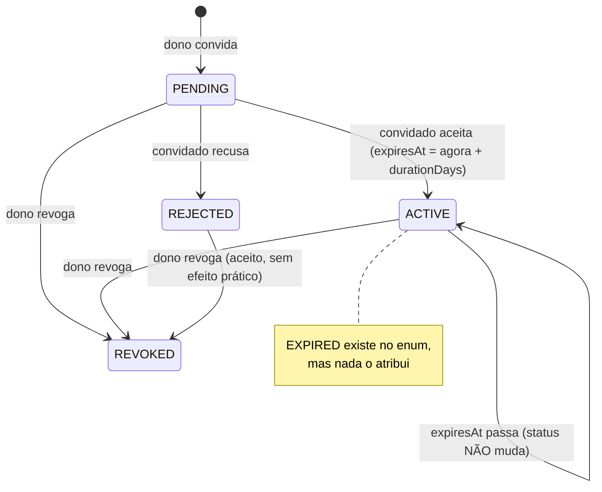
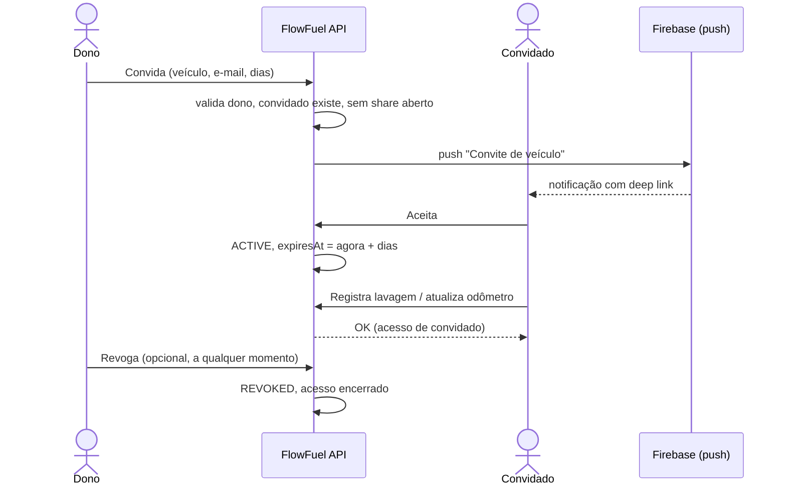

# Compartilhamento de Veículo (Vehicle Share)

> Fonte: `vehicleshare/VehicleShareController.java`, `vehicleshare/VehicleShareService.java`, `vehicleshare/VehicleShare.java`, `common/AuthorizationHelper.java`, `vehicle/VehicleService.java`, `vehicleevent/VehicleEventService.java`, `db/migration/V11__vehicle_shares.sql`

## Objetivo de Negócio

Permitir que o dono de um veículo o "empreste" por um prazo definido a outro usuário do FlowFuel, que passa a poder registrar despesas do dia a dia (abastecimento como evento, lavagem, pneus, outros) e atualizar o odômetro, sem virar dono do veículo.

## Atores

- **Dono** — usuário dono do veículo; convida, consulta e revoga.
- **Convidado** — outro usuário já cadastrado; aceita ou recusa e, enquanto ativo, usa o veículo.
- **Sistema (VehicleShareService / AuthorizationHelper)** — aplica as regras de convite e o controle de acesso do convidado.
- **Firebase Cloud Messaging** — entrega o push de convite ao convidado (ver [Notificações Push](notificacoes-push.md)).

## Ciclo de Vida

## Fluxo: Convidar (`POST /vehicle-shares`)

**Pré-condições:** dono autenticado; o convidado já tem conta no FlowFuel.

**Passos principais:**
1. Dono informa o veículo, o e-mail do convidado e a duração em dias (1 a 365).
2. Sistema confirma que o veículo existe e pertence ao dono.
3. Sistema localiza o convidado pelo e-mail.
4. Sistema confirma que o veículo não tem outro compartilhamento pendente ou ativo.
5. Convite é criado como **PENDING**; o prazo ainda não começa a contar.
6. Convidado recebe push "Convite de veículo" ("{dono} quer compartilhar o {marca} {modelo} com você"), com link direto para o convite.

**Exceções de negócio:**
- E-mail do convidado igual ao do dono → recusado ("Não é possível compartilhar o veículo com você mesmo").
- E-mail sem conta → "Usuário não encontrado". Não existe convite para quem ainda não se cadastrou.
- Veículo já tem convite pendente ou empréstimo ativo → conflito. Só um compartilhamento por veículo por vez.
- Veículo de outro usuário → proibido.

**Pós-condições:** convite visível em "pendentes" do convidado e como compartilhamento corrente do veículo para o dono.

## Fluxo: Responder ao Convite (`POST /vehicle-shares/{id}/accept` | `/reject`)

**Passos principais:**
1. Convidado vê os convites pendentes (`GET /vehicle-shares/pending`).
2. **Aceitar:** status vira ACTIVE e o prazo começa a contar a partir de agora (`expiresAt = agora + durationDays`).
3. **Recusar:** status vira REJECTED; o veículo fica livre para um novo convite.

**Exceções:** só o próprio convidado responde; convite que não está mais pendente (já respondido ou revogado) → "Convite não está mais disponível".

**Pós-condições:** nenhuma notificação é enviada ao dono sobre o aceite/recusa `[INFERIDO — confirmar se é intencional]`.

## Fluxo: Uso do Veículo pelo Convidado

Enquanto o compartilhamento está ACTIVE e `expiresAt` está no futuro, o convidado:

| Pode | Não pode |
|---|---|
| Ver o veículo em `GET /vehicle-shares/active-for-me` | Ver/editar o veículo via `GET/PUT /vehicles/{id}` (só dono) |
| Atualizar o odômetro (`PUT /vehicles/{id}/odometer`) | Registrar abastecimento via `POST /refuels` (só dono) |
| Criar eventos dos tipos `FUEL`, `CAR_WASH`, `TIRES`, `OTHER` | Criar eventos de `MAINTENANCE`, `OIL_CHANGE`, `INSURANCE`, `TAX`, `DOCUMENTS` ("Categoria não permitida para veículo emprestado") |
| | Listar/editar/excluir eventos, ver o dashboard, exportar relatórios (só dono) |

Fonte: `AuthorizationHelper.ensureOwnsOrHasGuestAccess` é usado apenas em `VehicleService.updateOdometer` e `VehicleEventService.create`; os demais endpoints continuam com `ensureOwnsVehicle`.

Eventos criados pelo convidado ficam no veículo do dono, sem registro de quem os criou (a entidade `VehicleEvent` não guarda autor).

## Fluxo: Revogar (`DELETE /vehicle-shares/{id}`)

Dono encerra o compartilhamento a qualquer momento (pendente ou ativo). Status vira REVOKED e o acesso do convidado acaba na hora. O convidado não é notificado.

## Fluxo: Consultar

- **Dono:** `GET /vehicle-shares/vehicle/{vehicleId}` → compartilhamento pendente ou ativo mais recente do veículo, ou "nenhum" (204).
- **Convidado:** `GET /vehicle-shares/pending` (convites a responder) e `GET /vehicle-shares/active-for-me` (empréstimos válidos).

## Diagrama

## Pontos de Atenção

- **Expiração não é materializada:** nada atribui `EXPIRED`. Após `expiresAt`, o share continua ACTIVE no banco. O acesso do convidado acaba corretamente (as checagens comparam `expiresAt > now`), mas: (a) o dono **não consegue convidar de novo** para o mesmo veículo (409 pelo check do service e pelo índice único parcial) até revogar manualmente; (b) `GET /vehicle-shares/vehicle/{id}` continua retornando o share vencido como ACTIVE. `[descoberto no código — provável bug]`
- **Enumeração de usuários:** convidar um e-mail inexistente retorna 404 com `detail` "Usuário não encontrado: {email}", o que revela quais e-mails têm conta. `[descoberto no código]`
- **Revogação sem checar status:** `revoke` aceita shares já REJECTED/REVOKED e sobrescreve `respondedAt`. `[descoberto no código]`
- **Convidado não consegue sair:** não há endpoint para o convidado encerrar um empréstimo ativo, só o dono revoga. `[INFERIDO — confirmar se é intencional]`
- **Acesso do convidado é parcial:** o convidado pode criar eventos, mas não pode listá-los nem ver o veículo pelos endpoints de veículo. O app precisa montar a tela a partir de `active-for-me`. `[INFERIDO — confirmar se é o escopo pretendido]`
- O push de convite é enviado dentro da transação de criação; se o commit falhar depois do envio, o convidado recebe push de um convite que não existe. `[descoberto no código — risco baixo]`
