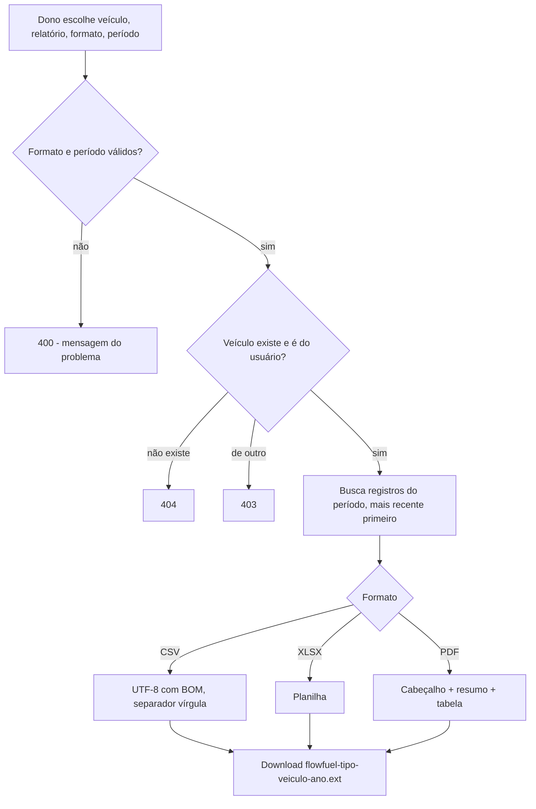

# Exportação de Relatórios (Exports)

> Fonte: `export/ExportController.java`, `export/ExportService.java`, `export/ExportFormat.java`, `export/strategy/*`, `export/util/ExportFileNameBuilder.java`

## Objetivo de Negócio

Permitir que o dono do veículo leve seu histórico para fora do app (planilha para análise, PDF para guardar ou enviar) com os abastecimentos ou as despesas/eventos de um veículo, opcionalmente num período.

## Atores

- **Usuário final (dono do veículo)** — escolhe veículo, tipo de relatório, período e formato.
- **Sistema (ExportService + estratégias CSV/XLSX/PDF)** — filtra os dados, monta o arquivo e o resumo.

## Fluxo: Exportar Abastecimentos (`GET /exports/refuels`)

**Pré-condições:** usuário autenticado e dono do veículo (convidado de [compartilhamento](compartilhamento-de-veiculo.md) não exporta).

**Passos principais:**
1. Usuário escolhe o veículo, o formato (CSV, XLSX ou PDF) e, opcionalmente, um período (início e fim juntos).
2. Sistema valida formato e período e confirma que o veículo é do usuário.
3. Busca os abastecimentos do período (ou todo o histórico), do mais recente para o mais antigo.
4. Monta uma linha por abastecimento: data, tipo de energia, quantidade, preço por unidade, total, odômetro.
5. **Somente no PDF**, acrescenta cabeçalho (título, "marca modelo — placa", período ou "Todo o histórico") e resumo: total gasto, total abastecido, consumo médio (mesma fórmula do dashboard, só com tanques cheios) e quantidade.
6. Devolve o arquivo para download com nome `flowfuel-refuels-{marca-modelo}-{ano}.{ext}`.

## Fluxo: Exportar Eventos (`GET /exports/events`)

Igual ao anterior, com filtro opcional por tipo de evento. Colunas: data, tipo, descrição, valor, odômetro. O resumo do PDF traz total gasto, quantidade de eventos e a contagem por tipo (do mais frequente ao menos).

**Exceções de negócio (ambos):**
- Formato desconhecido → "Formato de exportação inválido".
- Só uma das datas informada → "startDate e endDate devem ser informados juntos".
- Início depois do fim → "startDate não pode ser depois de endDate".
- Veículo inexistente → 404; de outro usuário → 403.
- Período sem registros → arquivo gerado só com o cabeçalho (sem erro) `[INFERIDO a partir do código — não há checagem de lista vazia]`.

**Pós-condições:** nada é gravado; o arquivo é gerado em memória a cada pedido.

## Diagrama

## Pontos de Atenção

- **Ano no nome do arquivo é o ano corrente**, não o do período exportado: exportar 2025 em 2026 gera `...-2026.csv`. `[descoberto no código]`
- **Proteção contra fórmula vaza para o PDF:** descrições iniciadas por `=`, `+`, `-` ou `@` recebem um `'` na frente em todos os formatos, inclusive no PDF, onde o apóstrofo aparece literalmente. `[descoberto no código]`
- **Números em formato americano no CSV** (`235.60`) com separador vírgula: no Excel pt-BR o CSV tende a abrir numa coluna só. O resumo do PDF, por outro lado, usa vírgula decimal (`235,60`). `[descoberto no código — confirmar expectativa do usuário]`
- **XLSX grava tudo como texto:** `ExcelExportStrategy` usa `setCellValue(String)` para todas as células, então valores e odômetro não são numéricos na planilha (não somam sem conversão). `[descoberto no código]`
- **Sem limite de linhas:** todo o histórico é carregado em memória para montar o arquivo. `[descoberto no código — risco baixo no volume atual]`
- Convidado de compartilhamento não pode exportar (usa `ensureOwnsVehicle`). `[INFERIDO — confirmar se é intencional]`
