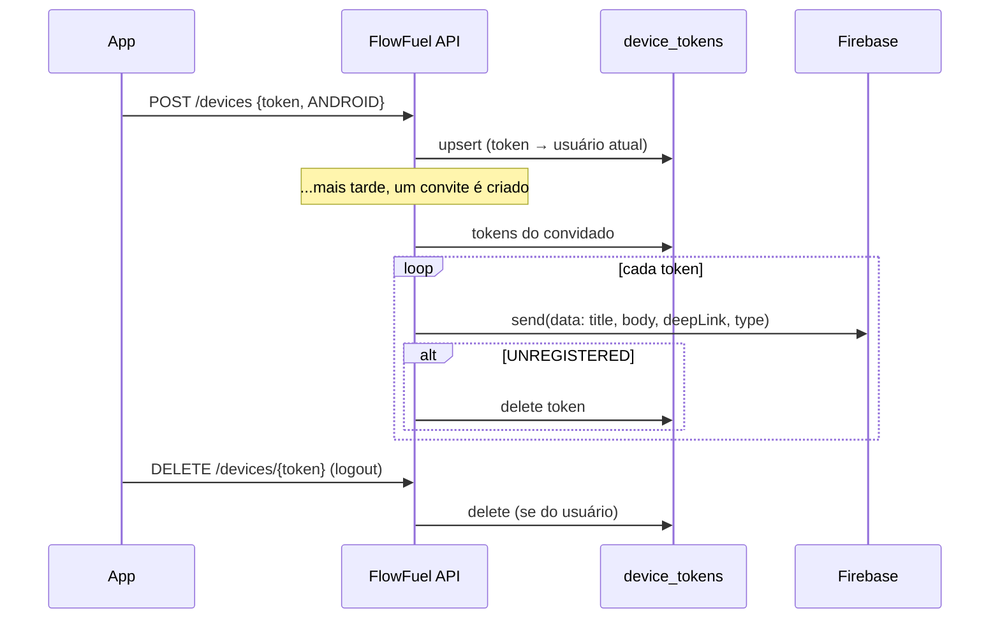

# Notificações Push (Devices)

> Fonte: `devicetoken/DeviceTokenController.java`, `devicetoken/DeviceTokenService.java`, `devicetoken/DeviceToken.java`, `push/*`, `common/AuthorizationHelper.java`

## Objetivo de Negócio

Permitir que a API avise o usuário no celular sobre algo que exige ação dele. Hoje o único uso é o convite de [compartilhamento de veículo](compartilhamento-de-veiculo.md).

## Atores

- **App (Android)** — obtém o token do Firebase e o registra/remove na API.
- **Usuário final** — dono dos dispositivos; não interage diretamente com estes endpoints.
- **Sistema (PushNotificationService)** — envia para todos os dispositivos do usuário.
- **Firebase Cloud Messaging (FCM)** — entrega a notificação.

## Fluxo: Registrar Dispositivo (`POST /devices`)

**Passos principais:**
1. Após o login, e sempre que o Firebase renova o token, o app envia o token e a plataforma (hoje só `ANDROID`) `[INFERIDO — momento de chamada descrito no OpenAPI, não no backend]`.
2. Se o token já existe, inclusive vinculado a **outra** conta (mesmo aparelho, usuário diferente), ele passa para o usuário atual. Senão, é criado.
3. Um usuário pode ter vários dispositivos.

## Fluxo: Remover Dispositivo (`DELETE /devices/{token}`)

1. No logout, o app remove o token do aparelho.
2. Token inexistente → sucesso silencioso (idempotente).
3. Token de outra conta → proibido (403).

## Fluxo: Envio de Push (interno)

1. Uma ação de negócio pede um push para um usuário (hoje: convite de compartilhamento).
2. Sistema busca todos os tokens do usuário; sem tokens, não faz nada.
3. Envia para cada token uma mensagem só de dados (`title`, `body`, `deepLink`, `type`).
4. Token que o Firebase diz não existir mais (`UNREGISTERED`) é apagado; outros erros só são logados.
5. Com `PUSH_ENABLED` desligado (padrão em dev/testes), o envio é substituído por um log.

## Pontos de Atenção

- **Mensagem só de dados:** o push não usa o bloco `notification` do FCM, só `data`. Quem exibe a notificação é o app; com o app fechado, isso depende da implementação do cliente. `[INFERIDO — confirmar com o time mobile]`
- **Envio síncrono:** o push roda na mesma thread (e na mesma transação) da ação de negócio; um FCM lento atrasa a resposta do convite. `[descoberto no código]`
- **Logout sem remover o token** (app desinstalado, falha de rede): o aparelho continua recebendo pushes da conta até o FCM marcar o token como `UNREGISTERED`. `[INFERIDO]`
- `platform` só aceita `ANDROID`; não há suporte a iOS/web. `[descoberto no código]`
