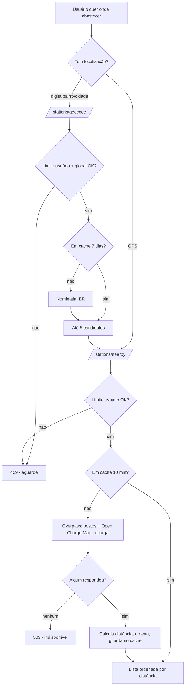

# Postos e Eletropostos Próximos (Stations)

> Fonte: `station/StationController.java`, `station/StationService.java`, `station/client/*`, `station/StationCacheService.java`, `station/GeocodeCacheService.java`, `station/HaversineUtil.java`

## Objetivo de Negócio

Ajudar o usuário a encontrar onde abastecer ou recarregar: lista postos de combustível e estações de recarga elétrica perto de um ponto, do mais próximo ao mais distante. O ponto pode ser a localização do aparelho ou um bairro/cidade digitado.

## Atores

- **Usuário final** — informa a localização (GPS ou texto) e o raio.
- **Sistema (StationService)** — limita o uso, consulta o cache, junta os provedores e calcula distâncias.
- **Overpass API (OpenStreetMap)** — fonte dos postos de combustível.
- **Open Charge Map** — fonte das estações de recarga elétrica.
- **Nominatim (OpenStreetMap)** — transforma texto em coordenadas.

## Fluxo: Buscar por Localização (`GET /stations/nearby`)

**Pré-condições:** usuário autenticado; latitude/longitude válidas.

**Passos principais:**
1. Usuário envia latitude, longitude e, opcionalmente, o raio (padrão 5 km).
2. Sistema verifica o limite de uso do usuário (10 buscas por minuto, somando busca e geocodificação).
3. Se a mesma área (coordenadas arredondadas a ~110 m e mesmo raio) foi buscada nos últimos 10 minutos, devolve o resultado guardado.
4. Caso contrário, consulta os postos de combustível (Overpass) e as estações de recarga (Open Charge Map, até 20).
5. Junta as duas listas, calcula a distância em linha reta de cada uma até o ponto e ordena da mais próxima para a mais distante.
6. Guarda o resultado por 10 minutos e devolve.

**Caminhos alternativos:**
- Um dos provedores fora do ar → devolve só o que o outro trouxe, sem avisar o usuário que a lista está incompleta.
- Os dois fora do ar → "serviço externo indisponível" (503).
- Limite excedido → "muitas requisições" (429) com o tempo de espera.
- Sem key do Open Charge Map configurada → só aparecem postos de combustível.

**Pós-condições:** nenhuma persistência no banco; só o cache Redis.

## Fluxo: Buscar por Bairro/Cidade (`GET /stations/geocode` → `GET /stations/nearby`)

**Passos principais:**
1. Usuário digita um local (3 a 100 caracteres), ex.: "Boa Viagem, Recife".
2. Sistema verifica o limite do usuário (mesmo bucket da busca) e o limite **global** de 1 consulta/segundo ao Nominatim, que vale para todos os usuários juntos.
3. Se o mesmo texto (sem diferenciar maiúsculas) foi consultado nos últimos 7 dias, devolve o resultado guardado.
4. Caso contrário, consulta o Nominatim restrito ao Brasil e devolve até 5 candidatos (nome completo + coordenadas).
5. O app escolhe um candidato e chama `/stations/nearby` com as coordenadas `[INFERIDO — o encadeamento é feito pelo cliente]`.

**Exceções:** texto curto/longo demais → 400; Nominatim fora do ar → 503; limite → 429.

## Diagrama

## Pontos de Atenção

- **Resultado parcial é cacheado por 10 min:** se um provedor falhou numa chamada, a lista incompleta fica no cache e é servida mesmo depois de ele voltar. `[descoberto no código]`
- **Raio sem limite superior:** `radius` só exige ser positivo. Um raio muito grande vai direto para a Overpass (timeout 10 s) e o Open Charge Map continua limitado a 20 resultados. `[descoberto no código]`
- **Limite global do Nominatim é consumido mesmo em cache hit:** `checkGeocodeGlobalRateLimit` roda antes da consulta ao cache, então dois usuários pesquisando o mesmo bairro no mesmo segundo recebem 429, ainda que a resposta esteja em cache. `[descoberto no código]`
- **Resultado vazio do geocode também é cacheado por 7 dias.** `[descoberto no código]`
- **`rating` é sempre null:** o campo existe na resposta, mas nenhum provedor o preenche. `[descoberto no código]`
- Distância é em linha reta (Haversine), não a distância de rota. `[INFERIDO — o app deve deixar isso claro ao usuário]`
- Rate limit e cache são fail-open: sem Redis, não há limite por usuário nem global, e o Nominatim pode ser chamado acima da política de uso. `[descoberto no código]`
