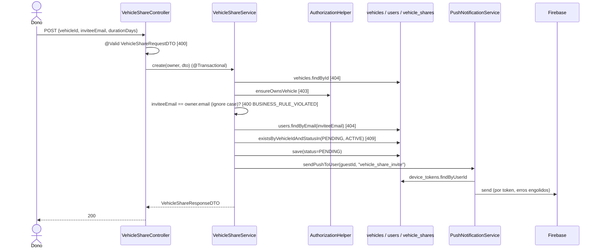
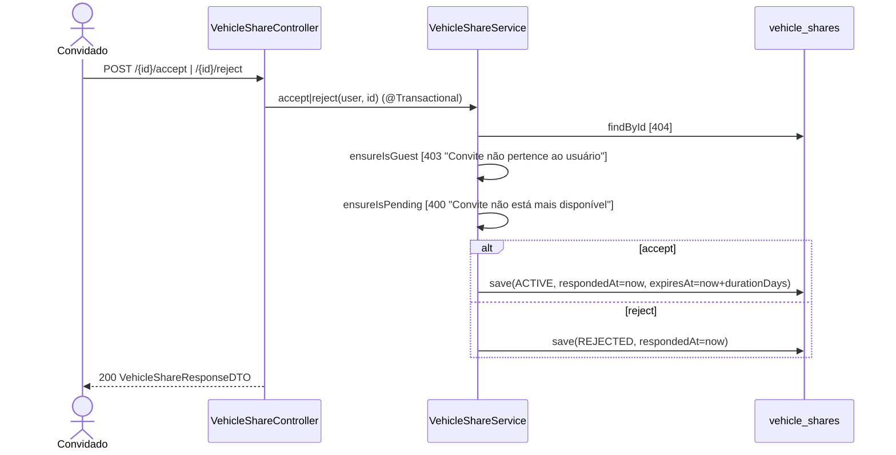

# Fluxo de Endpoints — Compartilhamento de Veículo

> Fonte: `vehicleshare/VehicleShareController.java`, `vehicleshare/VehicleShareService.java`, `vehicleshare/VehicleShareRepository.java`, `vehicleshare/VehicleShare.java`, `vehicleshare/dto/*`, `common/AuthorizationHelper.java`, `push/*`, `db/migration/V11__vehicle_shares.sql`.

Controller: `@RequestMapping("/vehicle-shares")` (`VehicleShareController.java:15`), prefixo `/api/v1` via `WebMvcConfig`. JWT obrigatório, sem rate limit. `create`, `accept`, `reject` e `revoke` são `@Transactional` (`VehicleShareService.java:33,68,82,95`); as consultas não são. Todas as respostas usam `VehicleShareResponseDTO.from`, que acessa `vehicle`, `owner` e `guest` (relações LAZY) e só funciona fora de transação porque `spring.jpa.open-in-view` está no default (`true`).

## `POST /vehicle-shares` — convidar

Fonte: `VehicleShareService.java:34-66`. Validação (`VehicleShareRequestDTO.java`): `vehicleId` `@NotNull`; `inviteeEmail` `@NotBlank @Email`; `durationDays` `@NotNull @Min(1) @Max(365)`.

- A comparação com o e-mail do dono é `equalsIgnoreCase`, mas `userRepository.findByEmail` é sensível a maiúsculas `[INFERIDO — depende de como o e-mail é normalizado no cadastro]`.
- Concorrência: dois `create` simultâneos podem passar pelo `exists` e um deles falha no índice único parcial `idx_vehicle_shares_active_unique` → `DataIntegrityViolationException` → **409 `CONFLICT`** com detail genérico "Recurso já existe ou viola uma restrição única".
- Push: `FirebasePushNotificationService` (se `PUSH_ENABLED=true`) ou `LoggingPushNotificationService`. Falhas de envio são capturadas por token e não afetam a resposta. Token `UNREGISTERED` é deletado dentro da transação do convite.
- Payload: `title` "Convite de veículo", `body` "{owner.name} quer compartilhar o {brand} {model} com você", `deepLink` `flowfuel://vehicle-share/{id}`, `type` `vehicle_share_invite`.

## `POST /vehicle-shares/{id}/accept` e `/reject`

Fonte: `VehicleShareService.java:69-93`, `:134-145`. Sem lock otimista/pessimista: aceite e revogação simultâneos resolvem pelo último `save` `[descoberto no código]`.

## `DELETE /vehicle-shares/{id}` — revogar

`findById` (404) → compara `share.owner.id` com o usuário (403 "Compartilhamento não pertence ao usuário") → `status=REVOKED`, `respondedAt=now` → **204**. Não verifica o status atual nem notifica o convidado. Fonte: `VehicleShareService.java:96-105`, `VehicleShareController.java:38-42`.

## `GET /vehicle-shares/vehicle/{vehicleId}`

`vehicles.findById` (404) → `ensureOwnsVehicle` (403) → `findFirstByVehicleIdAndStatusInOrderByCreatedAtDesc(PENDING, ACTIVE)`. Encontrado → **200**; senão o service devolve `null` e o controller responde **204** sem corpo (`VehicleShareController.java:44-49`). Não filtra `expiresAt`.

## `GET /vehicle-shares/pending` e `GET /vehicle-shares/active-for-me`

- `pending`: `findByGuestIdAndStatus(userId, PENDING)` (`VehicleShareService.java:119-124`).
- `active-for-me`: `findByGuestIdAndStatusAndExpiresAtAfter(userId, ACTIVE, now)` (`:126-132`).

Ambos sem paginação e sem `ORDER BY`. O mapeamento para DTO gera até 3 SELECTs lazy por item (N+1) `[descoberto no código — irrelevante no volume esperado]`.

## Efeito em outros recursos: acesso de convidado

`AuthorizationHelper.ensureOwnsOrHasGuestAccess` (`AuthorizationHelper.java:52-62`): dono passa direto; senão `existsByVehicleIdAndGuestIdAndStatusAndExpiresAtAfter(vehicleId, userId, ACTIVE, now)`, falso → 403 "Veículo não pertence ao usuário nem está compartilhado com ele". Usado só em:

| Endpoint | Restrição adicional para convidado |
|---|---|
| `PUT /vehicles/{id}/odometer` (`VehicleService.java:67-68`) | nenhuma |
| `POST /vehicle-events` (`VehicleEventService.java:35-40`) | `type` ∈ {FUEL, CAR_WASH, TIRES, OTHER}, senão 403 "Categoria não permitida para veículo emprestado" |

Os docs [veiculos.md](veiculos.md) e [eventos-de-veiculo.md](eventos-de-veiculo.md) ainda descrevem esses dois endpoints como "somente dono" (`ensureOwnsVehicle`) e precisam ser atualizados.

## Tabela de Erros → Status HTTP

| Exceção | Onde | Status | Code |
|---|---|---|---|
| Bearer ausente/inválido | `JwtAuthenticationFilter` | 401 | `AUTH_REQUIRED`/`AUTH_TOKEN_INVALID` |
| `MethodArgumentNotValidException` | `@Valid` no body | 400 | `VALIDATION_FAILED` |
| Convite para si mesmo | `VehicleShareService.create` | 400 | `BUSINESS_RULE_VIOLATED` |
| Convite não PENDING | `ensureIsPending` | 400 | `BUSINESS_RULE_VIOLATED` |
| Não é dono do veículo/share | `AuthorizationHelper` / `revoke` | 403 | `FORBIDDEN_OPERATION` |
| Não é o convidado | `ensureIsGuest` | 403 | `FORBIDDEN_OPERATION` |
| Veículo, usuário ou share ausente | `ResourceNotFoundException` | 404 | `RESOURCE_NOT_FOUND` |
| Share PENDING/ACTIVE existente | `ConflictException` | 409 | `CONFLICT` |
| Corrida no índice único | `DataIntegrityViolationException` | 409 | `CONFLICT` |
| Erro inesperado | catch-all | 500 | `INTERNAL_ERROR` |

## Pontos de Atenção

- `EXPIRED` nunca é atribuído e não há job de expiração: shares vencidos ficam ACTIVE e bloqueiam novos convites (409) e aparecem em `GET /vehicle/{id}`. Ver [business-flows/compartilhamento-de-veiculo.md](../business-flows/compartilhamento-de-veiculo.md#pontos-de-atenção). `[descoberto no código]`
- 404 com o e-mail no `detail` permite enumerar contas cadastradas. `[descoberto no código]`
- `POST /vehicle-shares` retorna 200, não 201, mesmo padrão dos demais `create` da API. `[descoberto no código]`
- `/vehicle-shares/vehicle/{vehicleId}` e `/vehicle-shares/{id}/accept` são paths ambíguos para validadores OpenAPI (Redocly `no-ambiguous-paths`). O Spring resolve corretamente porque `vehicle` é literal. `[descoberto na Fase 2]`
