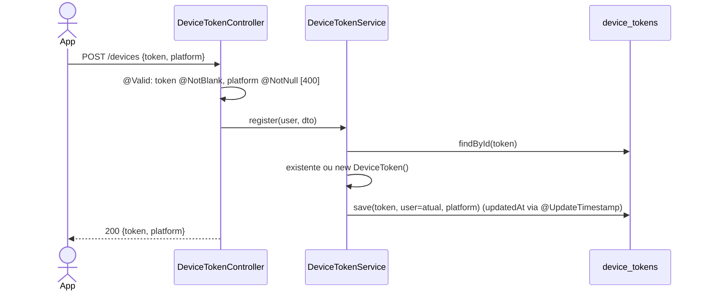
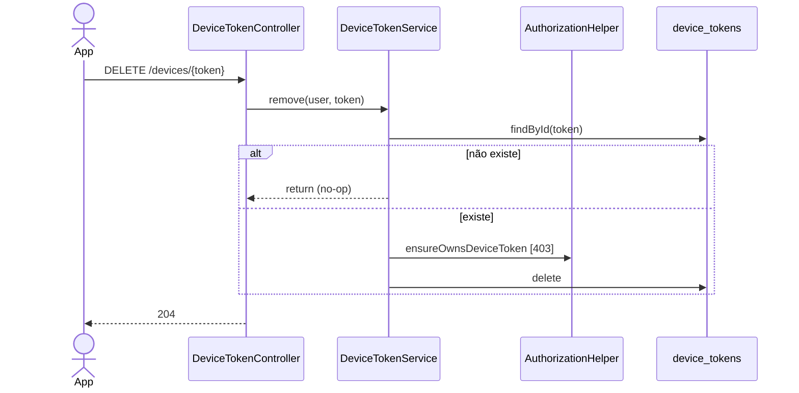

# Fluxo de Endpoints — Dispositivos (Push)

> Fonte: `devicetoken/DeviceTokenController.java`, `devicetoken/DeviceTokenService.java`, `devicetoken/DeviceTokenRepository.java`, `devicetoken/DeviceToken.java`, `devicetoken/dto/*`, `common/AuthorizationHelper.java`, `push/FirebasePushNotificationService.java`, `push/LoggingPushNotificationService.java`, `push/FirebaseConfig.java`, `db/migration/V10__device_tokens.sql`.

Controller: `@RequestMapping("/devices")` (`DeviceTokenController.java:18`). JWT obrigatório, sem rate limit, sem `@Transactional` (cada `save`/`delete` usa a transação do repositório).

## `POST /devices` — registrar (upsert)

Fonte: `DeviceTokenService.java:19-27`. A PK é o próprio token (`VARCHAR(255)`); um token de outro usuário é sobrescrito sem checagem de posse (intencional: mesmo aparelho, outra conta). `platform` fora do enum (`ANDROID`) → `HttpMessageNotReadableException` → 400 `REQUEST_MALFORMED` (não `VALIDATION_FAILED`). Sem `@Size(max=255)` no DTO: token maior que a coluna falha no banco `[INFERIDO — erro provável: DataIntegrityViolationException → 409 CONFLICT]`.

## `DELETE /devices/{token}` — remover

Fonte: `DeviceTokenService.java:29-37`, `AuthorizationHelper.java:40-44`. O token vai no path: tokens FCM contêm `:` e `-`, que são válidos em segmento de path, mas o cliente deve aplicar URL-encoding `[INFERIDO]`.

## Consumo interno: `PushNotificationService.sendPushToUser`

Seleção do bean por `flowfuel.push.enabled` (`PUSH_ENABLED`, default `false`):

- `false`/ausente → `LoggingPushNotificationService`: só `log.info("[PUSH] (stub) ...")`.
- `true` → `FirebaseConfig` cria `FirebaseMessaging` a partir de `PUSH_CREDENTIALS_JSON` (preferido) ou `PUSH_CREDENTIALS_FILE`. Credencial ausente ou inválida → falha no startup.

`FirebasePushNotificationService.sendPushToUser`: `findByUserId` → para cada token, `Message` só com `data` (`title`, `body`, `deepLink`, `type`, omitindo nulos) → `firebaseMessaging.send` síncrono. `UNREGISTERED` → `deviceTokenRepository.delete` + `WARN`; outro `FirebaseMessagingException` ou `RuntimeException` → `ERROR` (vai ao Sentry) e segue para o próximo token. Nenhuma exceção sobe para o chamador.

Único chamador hoje: `VehicleShareService.create` ([compartilhamento-de-veiculo.md](compartilhamento-de-veiculo.md)).

## Tabela de Erros → Status HTTP

| Exceção | Onde | Status | Code |
|---|---|---|---|
| Bearer ausente/inválido | `JwtAuthenticationFilter` | 401 | `AUTH_REQUIRED`/`AUTH_TOKEN_INVALID` |
| `token` em branco / `platform` nulo | `@Valid` | 400 | `VALIDATION_FAILED` |
| `platform` fora do enum | `HttpMessageNotReadableException` | 400 | `REQUEST_MALFORMED` |
| Token de outro usuário (DELETE) | `ensureOwnsDeviceToken` | 403 | `FORBIDDEN_OPERATION` |
| Erro inesperado | catch-all | 500 | `INTERNAL_ERROR` |

## Pontos de Atenção

- O OpenAPI documenta 400 de `POST /devices` como "Token ausente ou platform inválida" sem distinguir `VALIDATION_FAILED` de `REQUEST_MALFORMED`. `[descoberto na Fase 4]`
- Excluir a conta remove os tokens via `ON DELETE CASCADE` (V10), sem chamada ao FCM. `[descoberto no código]`
- Logout (`POST /auth/logout`) não remove tokens do lado do servidor; depende do app chamar `DELETE /devices/{token}`. `[INFERIDO — confirmar com o time mobile]`
