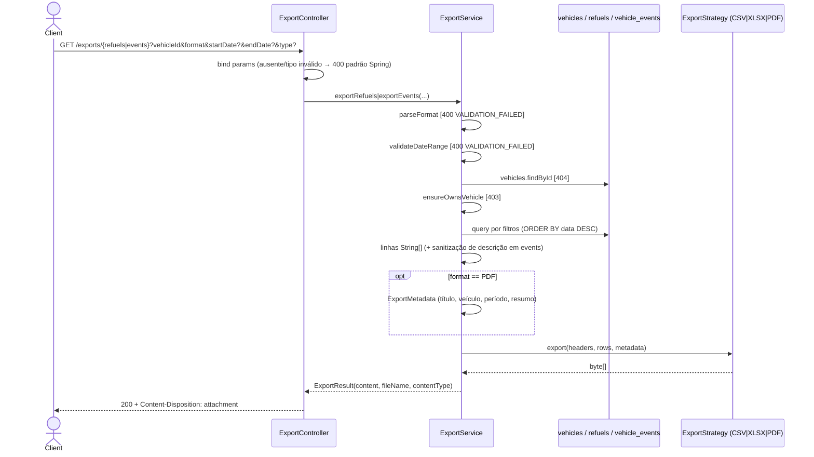

# Fluxo de Endpoints — Exportação

> Fonte: `export/ExportController.java`, `export/ExportService.java`, `export/ExportFormat.java`, `export/ExportValidationException.java`, `export/strategy/CsvExportStrategy.java`, `export/strategy/ExcelExportStrategy.java`, `export/strategy/PdfExportStrategy.java`, `export/util/ExportFileNameBuilder.java`.

Controller: `@RequestMapping("/exports")` (`ExportController.java:19`). JWT obrigatório, sem rate limit, sem `@Transactional`. As estratégias são beans `ExportStrategy` indexados por `supportedFormat()` num `Map` no construtor do service; duas estratégias para o mesmo formato derrubam o startup (`IllegalStateException`, `ExportService.java:50-65`).

## `GET /exports/refuels` e `GET /exports/events`

Fonte: `ExportService.java:67-91` (refuels), `:104-137` (events), `:223-245` (validações e content-type), `ExportController.java:48-56` (resposta).

**Ordem das validações:** formato → datas → existência do veículo → posse. Um pedido com formato inválido para um veículo alheio recebe 400, não 403.

**Consultas:**
- Refuels: com período → `findByVehicleIdAndRefuelDateBetweenOrderByRefuelDateDesc(start 00:00:00, end 23:59:59)`; sem período → `findByVehicleIdOrderByRefuelDateDesc`.
- Events: 4 variantes (tipo+período, só tipo, só período, nenhum), todas `ORDER BY eventDate DESC, createdAt DESC, id DESC`, mesmo padrão de `VehicleEventRepository` usado na listagem.

**Formatos:**

| Formato | Content-Type | Detalhes |
|---|---|---|
| CSV | `text/csv` | BOM UTF-8 (`EF BB BF`), separador `,`, quebra `\n`, aspas só quando o campo contém `,`, `"` ou `\n` (`CsvExportStrategy.java`) |
| XLSX | `application/vnd.openxmlformats-officedocument.spreadsheetml.sheet` | Apache POI, cabeçalho com estilo, todas as células como texto (`ExcelExportStrategy.java:54-65`) |
| PDF | `application/pdf` | Cabeçalho + resumo + tabela a partir de `ExportMetadata` (`PdfExportStrategy.java`); CSV/XLSX recebem `ExportMetadata.EMPTY` |

**Nome do arquivo** (`ExportFileNameBuilder.java`): `flowfuel-{refuels|events}-{slug}-{Year.now()}.{ext}`; slug = marca+modelo sem acentos, minúsculo, não alfanumérico → `-`; vazio → `veiculo-{id}`.

**Resumo do PDF:**
- Refuels (`:172-189`): total gasto, total de energia + `vehicle.getEnergyUnit()`, consumo médio via `RefuelConsumptionCalculator.calculateAverageConsumption` sobre os `fullTank` (exibe `-` se 0) + `getConsumptionUnit()`, contagem.
- Events (`:191-206`): total gasto, contagem, contagem por `type` em ordem decrescente.

## Side effects

Nenhum: sem escrita no banco, sem cache, sem auditoria. O arquivo é montado inteiro em memória (`byte[]`).

## Tabela de Erros → Status HTTP

| Exceção | Onde | Status | Code |
|---|---|---|---|
| Bearer ausente/inválido | `JwtAuthenticationFilter` | 401 | `AUTH_REQUIRED`/`AUTH_TOKEN_INVALID` |
| `vehicleId`/`format` ausente | Spring MVC (`MissingServletRequestParameterException`) | 400 | sem `code` (ProblemDetail padrão) |
| Data ou `type` com formato inválido | Spring MVC (`TypeMismatchException`) | 400 | sem `code` `[INFERIDO — ver nota em postos.md]` |
| Formato desconhecido | `ExportValidationException` | 400 | `VALIDATION_FAILED` (sem `errors[]`) |
| Só uma data / início > fim | `ExportValidationException` | 400 | `VALIDATION_FAILED` |
| Veículo não encontrado | `ResourceNotFoundException` | 404 | `RESOURCE_NOT_FOUND` |
| Não é dono | `AuthorizationHelper.ensureOwnsVehicle` | 403 | `FORBIDDEN_OPERATION` |
| Erro inesperado (ex.: falha do POI/PDF) | catch-all | 500 | `INTERNAL_ERROR` |

## Pontos de Atenção

- `format` é `String` livre no controller e só é validado no service; por isso o OpenAPI documenta o enum, mas o Spring não o aplica. `[descoberto no código]`
- Fim do período usa `23:59:59`, então um abastecimento às `23:59:59.500` fica de fora. `[descoberto no código — risco baixo]`
- Sem limite de linhas nem streaming. `[descoberto no código]`
- Sanitização anti-fórmula (`sanitizeSpreadsheetCell`, `:149-157`) só é aplicada à descrição de eventos e também afeta o PDF. `[descoberto no código]`
- Ano do nome do arquivo é `Year.now()`, independente do período. `[descoberto no código]`
