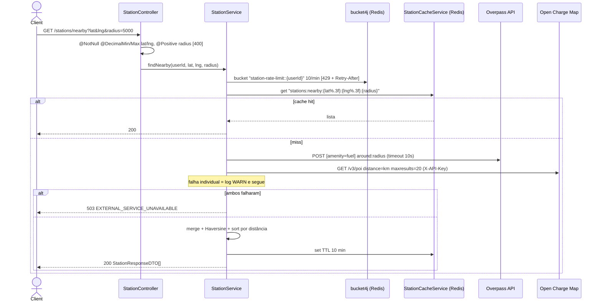
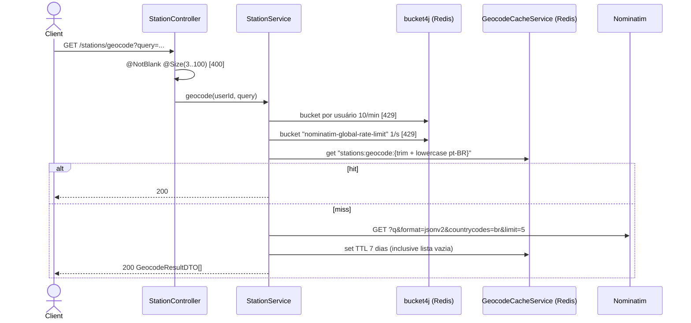

# Fluxo de Endpoints — Postos (Stations)

> Fonte: `station/StationController.java`, `station/StationService.java`, `station/StationCacheService.java`, `station/GeocodeCacheService.java`, `station/HaversineUtil.java`, `station/client/OverpassClient.java`, `station/client/OpenChargeMapClient.java`, `station/client/NominatimClient.java`, `application.properties:104-114`.

Controller: `@RequestMapping("/stations")` + `@Validated` (`StationController.java:23-26`): os parâmetros de query são validados por Bean Validation no método, e violações geram `ConstraintViolationException` → 400 `VALIDATION_FAILED` com `errors[]`. Nenhum método é `@Transactional` (não há acesso ao banco). Rate limit e cache são feitos no service com a mesma conexão Redis/Lettuce do `RateLimitingConfig`, obtida via `ObjectProvider` (ausente → fail-open).

## `GET /stations/nearby`

Fonte: `StationService.java:64-106` (`findNearby`), `:143-163` (`checkRateLimit`), `:165-171` (chave).

- **Overpass** (`OverpassClient.java`): query `[out:json][timeout:10];nwr(around:{r},{lat},{lng})[amenity=fuel];out center;` via POST `text/plain`. Usa `lat/lon` do nó ou `center` de way/relation; sem coordenada → descartado. `name` ausente → "Posto de combustível"; `placeId` `osm:{type}/{id}`; `street`/`houseNumber` das tags `addr:*`.
- **Open Charge Map** (`OpenChargeMapClient.java`): `X-API-Key` só é enviado se `OPEN_CHARGE_MAP_API_KEY` não estiver vazio; a API responde 403 sem key, o que vira exceção e resultado só FUEL. `name` ausente → "Estação de recarga"; `placeId` `ocm:{ID}`; `houseNumber` sempre null.
- Ambos os clientes enviam `User-Agent: FlowFuel/1.0 (+https://flowfuel-api.fly.dev)` e convertem `RestClientException` em `ExternalServiceUnavailableException`.
- Falha de um provedor não é exposta na resposta (sem flag de resultado parcial), e o resultado parcial é cacheado.

## `GET /stations/geocode`

Fonte: `StationService.java:108-121` (`geocode`), `:123-141` (limite global), `NominatimClient.java`. `lat`/`lon` chegam como string e são convertidos com `Double.parseDouble`; `NumberFormatException` também vira 503.

- O `@Size(min=3)` é checado antes do `trim()`: `"  a "` passa na validação e é enviado ao Nominatim como `"a"`. `[descoberto no código]`

## Side effects

- Escrita no Redis (cache) em todo cache miss bem-sucedido.
- Logs `WARN` em falha de provedor, de cache ou de rate limit (fail-open). Nada é enviado ao Sentry (4xx/fail-open não chegam a `ERROR`).
- 429 inclui header `Retry-After` (segundos, mínimo 1) via `GlobalExceptionHandler.handleRateLimitExceeded`.

## Tabela de Erros → Status HTTP

| Exceção | Onde | Status | Code |
|---|---|---|---|
| Bearer ausente/inválido | `JwtAuthenticationFilter` | 401 | `AUTH_REQUIRED`/`AUTH_TOKEN_INVALID` |
| Parâmetro obrigatório ausente (`lat`, `lng`, `query`) | Spring MVC (`MissingServletRequestParameterException`, handler padrão) | 400 | sem `code` (ProblemDetail padrão do Spring) |
| Parâmetro com tipo inválido (`lat=abc`) | Spring MVC (`TypeMismatchException`, handler padrão) | 400 | sem `code` `[INFERIDO — ver nota abaixo]` |
| Faixa/tamanho inválido | `ConstraintViolationException` | 400 | `VALIDATION_FAILED` |
| Limite por usuário ou global | `RateLimitExceededException` | 429 | `RATE_LIMIT_EXCEEDED` |
| Provedores indisponíveis | `ExternalServiceUnavailableException` | 503 | `EXTERNAL_SERVICE_UNAVAILABLE` |
| Erro inesperado | catch-all | 500 | `INTERNAL_ERROR` |

Nota: `GlobalExceptionHandler` estende `ResponseEntityExceptionHandler`, que no Spring 6 / Boot 3.5 trata `TypeMismatchException` como 400. Isso diverge da afirmação de [eventos-de-veiculo.md](eventos-de-veiculo.md) e [abastecimentos.md](abastecimentos.md) de que enum inválido em query param vira 500. `[confirmar com teste e corrigir o doc que estiver errado]`

## Pontos de Atenção

- `radius` sem `@Max`: raio arbitrário é repassado à Overpass. `[descoberto no código]`
- Resultado parcial cacheado por 10 min; resultado vazio de geocode cacheado por 7 dias. `[descoberto no código]`
- Limite global do Nominatim é consumido antes do cache hit. `[descoberto no código]`
- Overpass e Open Charge Map são chamados em sequência, não em paralelo: a latência de cache miss é a soma das duas. `[descoberto no código]`
- O `RestClient` não define timeout de conexão/leitura explícito; só a query Overpass tem `timeout:10` no lado do servidor. `[INFERIDO — depende dos defaults do RestClient.Builder]`
- `ExternalServiceUnavailableException`/`EXTERNAL_SERVICE_UNAVAILABLE` não constava no enum `code` do `ProblemDetail` no OpenAPI; adicionado nesta revisão.
